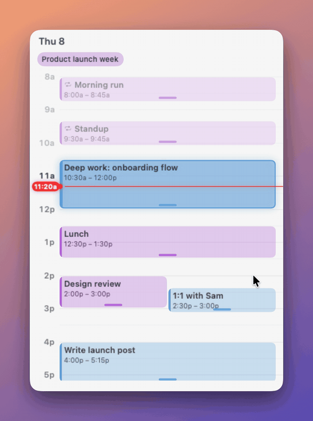

# HeyDay

A small macOS desktop widget that shows your [HEY Calendar](https://www.hey.com/calendar/) day as a timeline. It sits on the desktop (or floats above windows) and talks to HEY through the official [`hey` CLI](https://www.hey.com/agents/).

<p align="center"></p>

## Features

- Day timeline with a live "now" line and the current event highlighted
- Drag on empty space to create an event, or double-click for a quick one
- Drag events to move them, drag the bottom edge to resize, double-click to rename, right-click to delete
- Repeating events: edits apply to that day's occurrence only
- All-day events in a strip under the header
- Browse days with the arrows (hover the header); **Today** jumps back
- Cached days and background prefetch of the neighbouring days, so switching is instant
- Settings: target calendar, time zone, double-click length, hour height, visible hours (e.g. 8a–5p), float above windows

## Install

You need macOS 13 or later and a HEY account. That's it.

[**Download HeyDay.zip**](https://github.com/yazinsai/hey-widget/releases/latest/download/HeyDay.zip), unzip, drag `HeyDay.app` into Applications and open it. It's signed and notarized by Apple, so it opens like any other app.

Or from Terminal:

```sh
curl -fsSL https://github.com/yazinsai/hey-widget/releases/latest/download/HeyDay.zip -o /tmp/HeyDay.zip && ditto -xk /tmp/HeyDay.zip /Applications && open /Applications/HeyDay.app
```

### First run

HeyDay walks you through the rest in the widget itself:

1. **Install the hey CLI**: one click. It runs HEY's [official installer](https://www.hey.com/agents/) into `~/.local/bin`. No admin password, nothing else to set up.
2. **Sign in to HEY**: your browser opens HEY's sign-in page. Approve it and the widget loads your day.

If you already have the `hey` CLI and are signed in, HeyDay skips straight to your calendar. It also adds itself to your login items; turn that off under Settings → Open at login.

HeyDay looks for `hey` in `$HEY_PATH`, `~/.local/bin`, `~/bin`, `~/go/bin`, `/opt/homebrew/bin`, then `/usr/local/bin`. Use the menu bar icon → **Sign Out of HEY** to switch accounts.

### Build from source

Needs Xcode Command Line Tools (`xcode-select --install`).

```sh
git clone https://github.com/yazinsai/hey-widget.git
cd hey-widget
./build.sh install
```

This builds `HeyDay.app`, copies it to `~/Applications` and launches it. `./build.sh` alone builds into `build/`.

### Releasing

Needs a Developer ID Application certificate in your keychain and a notarytool profile (`xcrun notarytool store-credentials heyday-notary ...`). Then:

```sh
PUBLISH=1 VERSION=v0.2.0 ./build.sh release
```

That builds a universal (Apple silicon + Intel) app, signs it with hardened runtime, notarizes and staples it, then tags the version and creates the GitHub release with `build/HeyDay.zip`. Without `PUBLISH=1` it stops after the notarized zip.

## Usage

- Drag the header to move the widget; resize from the window edges.
- Hover the header for day navigation and the settings gear.
- The menu bar icon has Refresh, Settings and Quit.
- A red dot next to the date means the last `hey` call failed; hover it for the error, click to dismiss.

New events go to your **Personal** calendar by default; pick another in Settings.

### Demo mode

`HEYDAY_DEMO=1` shows sample events with the clock pinned to 11:20 (no `hey` calls). Add `HEYDAY_SNAPSHOT=out.png` to write a 2x PNG of the window and quit — that's how `docs/screenshot.png` is made:

```sh
HEYDAY_DEMO=1 HEYDAY_SNAPSHOT=$PWD/docs/screenshot.png ./build/HeyDay.app/Contents/MacOS/HeyDay
swift scripts/desktop-shot.swift docs/screenshot.png docs/screenshot-desktop.png
```

The second command places it on a generated desktop.

`scripts/demo-gif.sh` renders `docs/demo.gif`: with `HEYDAY_RECORD=dir` the app plays a scripted session (drag-create, type, resize, switch days) using synthetic input and writes each frame, then ffmpeg turns them into a GIF. Needs ffmpeg and ImageMagick.

## License

[MIT](LICENSE)
